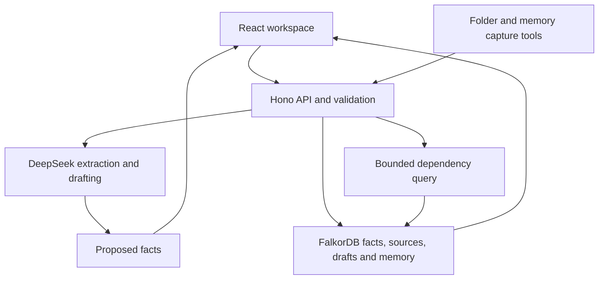

# PromiseGraph

Graph Hacks entry · **Company Brain** track.

## AI assistance disclosure

Development used AI coding assistance, including ChatGPT/Codex and DeepSeek-based coding sessions, for implementation, debugging, documentation and test support. The empty-state illustration is AI-generated. Published component sources and reused code are attributed below and in `THIRD_PARTY_NOTICES.md`; those components are not claimed as original work. Runtime extraction and drafting call DeepSeek; dependency risk and review decisions use explicit application rules and FalkorDB queries. The demo uses fictional customer data.

## Context

PromiseGraph connects a customer commitment to the engineering work it requires. It preserves original source text, proposes facts with DeepSeek, requires human review, queries risk paths in FalkorDB, and prepares an editable follow-up.

This is a single-owner application with a real persistent FalkorDB backend. The fictional walkthrough is explicitly loaded by the user; it is not model output. Nothing is sent to a customer by this application.

## Run

Requirements: Node 22 or later, npm, and Python 3.12 on macOS for the native setup helper.

```sh
npm ci
npm run setup:native
npm run build
npm start
```

Open **http://127.0.0.1:4174**. On Linux, the native setup helper exits without changes; the official npm platform package supplies the binaries. A remote FalkorDB connection can also be used.

On this prepared Mac workspace, double-click **Launch-PromiseGraph.command** to build, run the integration checks in temporary local databases, and start the frontend and backend together. The check output is saved in `.data/launch-checks.log`. Keep its terminal window open while using the application.

Open **Settings & connections → DeepSeek** and enter your DeepSeek API key. The application verifies it against DeepSeek and keeps it in server memory for that server session. The key is not returned, logged, or saved in browser storage. Alternatively, configure `DEEPSEEK_API_KEY` in an ignored `.env.local` before startup. Do not commit credentials.

The existing private Site hosts the frontend only. Connect it to an HTTPS-hosted PromiseGraph server in its connection settings. Cloudflare Workers cannot run the native graph process or connect over raw TCP. The local application serves both the frontend and API from the same origin.

## Workflow

1. Import text, a text file, or a Markdown file.
2. Extract proposed facts with DeepSeek, or add them manually using exact source excerpts.
3. Review, correct, confirm, or reject each proposed fact.
4. Inspect the selected commitment's customer → promise → feature → task path.
5. Confirm a new task schedule through a source. FalkorDB recomputes the affected promises.
6. Create a follow-up task from an at-risk commitment. Repeated clicks reuse the task for that graph revision. Track it in the Follow-ups tab and mark it complete or reopen it.
7. Generate a customer follow-up with DeepSeek and edit its wording.
8. Save the reviewed draft. A changed graph revision rejects a stale save.
9. Recall saved commitments, follow-up tasks, drafts, and confirmed memory across sessions and server restarts. Read confirmed and rejected facts in each source's Fact history tab.

Tentative schedules cannot become authoritative. A task's release date is not a confirmed customer delivery date. Generation does not send a message or count as a saved reviewed outcome.

## Architecture



FalkorDB owns typed relationships and the risk query. Source records, proposed claims, confirmed facts, schedule-change events, reviewed drafts, and memories all persist in the graph. Local mode uses append-only persistence with `appendfsync always`. The native process binds only to loopback and uses a random per-process database password.

The DeepSeek adapter uses the official documented OpenAI-compatible API format with `baseURL=https://api.deepseek.com` and `model=deepseek-flash`, verified against the current DeepSeek documentation on 15 October 2026. Using its protocol SDK does not use the OpenAI service.

The small fixed schema uses parameterized Cypher, exact evidence checks, serialized writes, bounded queries, explicit failure responses, a source review boundary, and idempotent import IDs. A review decision writes its fact and revision in one graph query. Historical schedule changes retain their source and prior date.

## Graph data model and queries

| Nodes | Purpose and relationships |
|---|---|
| Customer, Promise | `Customer-[:WAS_PROMISED]->Promise`; the promise stores its owner and promised date |
| Feature, Task | `Promise-[:REQUIRES]->Feature-[:DEPENDS_ON]->Task`; a task stores its confirmed engineering date |
| Source, Claim | `Source-[:HAS_CLAIM]->Claim`; pending claims affect no active commitments; approved facts retain exact quotes and `SUPPORTED_BY` source links |
| Event | `Task-[:HAS_EVENT]->Event-[:SUPPORTED_BY]->Source`; retains the previous and revised schedule |
| FollowUp | `FollowUp-[:FOLLOWS_UP]->Promise`; records owner, status and evidence revision |
| Draft, Memory, Workspace | Drafts reference a promise ID and evidence revision; confirmed memories can link to their source; Workspace stores the current graph revision |

The production Cypher lives in [`server/store.ts`](server/store.ts). The core risk query traverses confirmed relationships rather than asking the model to guess risk:

```cypher
MATCH (p:Promise)
OPTIONAL MATCH (p)-[:REQUIRES]->(f:Feature)
OPTIONAL MATCH (f)-[:DEPENDS_ON]->(t:Task)
WITH p, collect(DISTINCT t) AS tasks
RETURN p.id AS id,
  CASE
    WHEN any(t IN tasks WHERE t.due_at > p.due_at) THEN 'at_risk'
    WHEN size(tasks) = 0 OR any(t IN tasks WHERE t.due_at IS NULL) THEN 'unverified'
    ELSE 'on_track'
  END AS status
```

Dates use validated ISO `YYYY-MM-DD` strings. The bounded evidence traversal used before entity and current-plan filtering is:

```cypher
MATCH (p:Promise {id: $id})-[:REQUIRES|DEPENDS_ON*0..2]->(n)
      -[:SUPPORTED_BY]->(s:Source)
WITH DISTINCT s
MATCH (s)-[:HAS_CLAIM]->(c:Claim {status: 'approved'})
RETURN DISTINCT c.id, c.kind, c.source_id, c.quote, c.payload
```

FalkorDB is the persistent source of truth for these paths and their evidence, not a visualization-only dependency. Saving a reviewed draft requires the same graph revision used for generation; a changed revision returns a conflict.

| Feature | Runtime implementation |
|---|---|
| Proposed fact extraction | Real DeepSeek chat-completion request and structured model output |
| Follow-up wording | Real DeepSeek chat-completion request using selected evidence |
| Dependency risk | FalkorDB relationship query and date rules |
| Human review, saved drafts, tasks and memory | Validated application operations and persistent graph records |

The production server constructs the DeepSeek adapter with its real HTTPS transport. Provider-response fixtures are injected only by tests. The fictional walkthrough is a separate, labelled action. A configured key is not evidence of successful live generation.

Only evidence consistent with the current graph plan is sent to drafting. Historical source bodies are excluded from the model's drafting input; source titles and exact current excerpts remain attached. Completing a follow-up does not change a customer deadline or mark an engineering task as delivered.

## Code reused

See [THIRD_PARTY_NOTICES.md](THIRD_PARTY_NOTICES.md) and [component-sources/manifest.json](component-sources/manifest.json) for original registries, content hashes and modifications. The refreshed UI uses 15 newly copied registry components plus the existing 21st TextShimmer: Aceternity Sidebar and Bento Grid, 12 shadcn components, and Componentry Circuit Board. Layout and data adapters connect these published components to the existing API. Dark and light themes follow the supplied Interfere reference.

- **Rowboat:** incremental folder-state processor, adapted for atomic, destination-specific checkpoints and acknowledged content checks.
- **Memory Store historical plugin:** capture script and JSONL format, connected to our acknowledged FalkorDB memory writer. The flush command retains failed records, recovers interrupted batches, and preserves records queued during processing.
- **Memory Store current plugin:** explicit check-in, selected evidence, confirmed outcomes, and receipt rules adapted into the agent policy.
- **21st Agent Elements:** its actual TextShimmer registry component, used during extraction and drafting.

Memory Store's private hosted database and ranking backend are not public in the inspected repositories. This application does not claim to contain that unpublished code.

## Libraries and design choices

| Area | Choice | Reason and alternative considered |
|---|---|---|
| UI | React 19 + TypeScript + Vite | Fits the reused Rowboat React component; avoids carrying Electron into a web application |
| Data fetching | TanStack Query | Handles invalidation, request state, and fresh recalls instead of hand-maintained fetch state |
| Visual primitives | Published shadcn/ui registry components | Buttons, forms, cards, tabs, dialogs, alerts and feedback; Radix supplies their focus and keyboard behavior |
| Graph views | Componentry Circuit Board | Actual confirmed graph data, keyboard selection, relationship inspection and a searchable entity list |
| Icons | Lucide React | Consistent library SVGs shared with the source component, replacing text glyphs |
| Design system | Interfere reference + Inter Variable | Shared dark/light semantic tokens, compact typography, blue actions and subtle borders on every screen |
| Motion | Motion + CSS transitions | Short feedback and dialog transitions, with reduced-motion support; no decorative infinite graph motion under reduced motion |
| Feedback | Sonner | Accessible consistent success/error notifications |
| API | Hono + Zod | Small HTTP layer with validated inputs; no unnecessary service split |
| Graph | Official FalkorDB driver and native binaries | Runs actual Cypher and persists connected facts; no in-memory graph substitute |
| AI | DeepSeek through the documented compatible SDK | JSON extraction, bounded output, timeouts, retry handling, and explicit failure states |
| Import tooling | Rowboat checkpoint code + YAML | Source-at-a-time imports; YAML title/author metadata preserved alongside the original text |

Applied skills: UI/UX Pro Max, Senior Backend Developer, Emil Design Engineering, Find Skills, and Ego Browser. The design-system search was used as guidance; its landing-page suggestions were not copied into this application workspace. Relevant official documentation was reviewed; this is not a claim to have read every page of the vendors' documentation.

## Capture tools

Import a folder of Markdown sources, with success-only incremental checkpoints:

```sh
npm run import:folder -- /absolute/path/to/notes
```

Capture a confirmed decision and flush the queue:

```sh
bash tools/capture-memory.sh --memory "The team confirmed the revised plan" --importance normal
npm run memory:flush
```

`PROMISEGRAPH_SERVER` selects a different API origin. `APP_ACCESS_TOKEN` authenticates CLI calls to a hosted server. Folder imports save source text; they do not automatically confirm facts or spend AI credits.

Import checkpoints are separated by server address, skip symbolic links, and record the acknowledged content hash. Files edited during upload remain retriable. Imports and memory delivery require a valid JSON acknowledgement from the API. Partial failures exit with a nonzero status; failed or malformed memory records stay queued. The capture helper preserves Unicode, newlines and JSON control characters. Interrupted default queue batches are excluded from Git and Docker uploads.

## Configuration

| Variable | Purpose |
|---|---|
| `DEEPSEEK_API_KEY` | Persistent server-side DeepSeek connection |
| `DEEPSEEK_MODEL` | Model override; current documented model is `deepseek-flash` |
| `DATA_DIR` | Native graph data directory; default `.data/falkordb` |
| `FALKORDB_HOST`, `FALKORDB_PORT` | Optional remote FalkorDB server |
| `FALKORDB_USERNAME`, `FALKORDB_PASSWORD`, `FALKORDB_TLS` | Remote database authentication and TLS |
| `FALKORDB_MODULE_PATH`, `FALKORDB_REDIS_PATH` | Official binary overrides |
| `HOST`, `PORT` | Application listener; defaults `127.0.0.1:4174` |
| `APP_ACCESS_TOKEN` | Required before exposing the application on a public interface |
| `ALLOWED_ORIGINS` | Comma-separated exact allowed frontend origins |

Remote deployment is **one owner and one workspace**, not a team permission system. Run one application process per graph workspace. Before using real customer information, provision an appropriately hosted server, HTTPS, access controls, backups, and the required account permissions.

## Verification

For a fast check without credentials, API credits or local listeners:

```sh
npm run verify:controlled
```

This runs 34 controlled tests and the TypeScript/production build. It does not load `.env.local`. Tests use the real HTTP handlers, DeepSeek SDK and application guards with controlled provider/query replies. They cover extraction grounding, malformed/truncated output, provider failures, explicit review, draft editing and saving, stale evidence, follow-up tasks, memory request contracts, frontend states, malformed server responses, and capture-tool recovery. They do not execute Cypher, prove database persistence, or measure live model quality.

Use `npm run test:controlled` for the tests alone, or `npm run test:ai` for the seven provider-response groups. The controlled verifier saves `.data/verification-controlled.json` and its own history; a passing controlled report never replaces the full verification report.

To verify only the real DeepSeek integration, independently of database startup:

```sh
npm run verify:ai
```

This loads the existing server configuration, verifies the key and model, then calls the production adapter for real extraction and drafting with fictional input. No provider fixture is supplied. It checks exact-source grounding and the explicit commitment/dependency/schedule, then checks that drafting returns text. This focused smoke check does not establish broad model quality. It can consume DeepSeek credits and records `.data/verification-ai.json`. No facts or messages are saved or sent to customers.

For the complete local, live-service and browser check:

```sh
npm run verify
```

The same command runs from **Verify-PromiseGraph.command**. It includes the controlled checks, an isolated real FalkorDB integration suite, live DeepSeek key/model verification and an isolated extraction → review → graph risk → drafting → reviewed save → follow-up → restart recall workflow. Live checks can consume the configured DeepSeek account's credits. Tests use temporary local graphs, regardless of production database settings. `npm test` runs all test files, including the real-database integration suite.

When its desktop connection is available, the Ego browser layer uses the built application and an isolated real graph. It checks memory after reload, horizontal overflow, graph reachability and populated graphs at 1440, 768 and 390 pixels, and writes pixel captures to `.data/browser/`. An overflow check alone does not certify the interface.

The full verifier writes `.data/verification.json` and appends `.data/verification-history.jsonl`. Each layer reports passed, failed or blocked. Blocked layers remain in the denominator and produce a nonzero exit status. Counts describe verification coverage, not product-completion percentages.

Current results on 16 October 2026: **34 controlled tests, 37 tests including the real FalkorDB integration suite, and the production build pass**. The full verifier passes **9 of 9 layers with zero failed and zero blocked**: real FalkorDB queries and restart persistence, live DeepSeek key/model verification, real extraction and drafting, an isolated extraction → review → risk → draft → follow-up → restart workflow, and an Ego browser pass at 1440, 768 and 390 pixels with pixel captures. Three independent audits (frontend browser QA, backend/API integrity, code and design) are complete; the real defects they found — oversized-upload connection handling, unknown API paths returning the HTML shell, tokens accepted without `Bearer`, a follow-up dialog that could not close, a counter that ignored the active filter, mid-word previews and untitled captions — were reproduced, fixed and re-verified, and the rest are recorded as deviations. Model quality, prompt-injection resistance and long-run behaviour are not certified by these passes. The persistent HTTPS backend is still not provisioned and the private Site still serves the earlier frontend, so the app is verified locally but not deployed. See [GATES.md](GATES.md) for current completion gates and known deviations.

The current fixes cover sidebar/mobile-drawer state, cached workspace recovery after a failed background health check, pre-render theme and denied storage, accurate DeepSeek connection errors and verified key replacement, stale evidence changing during draft/follow-up reads, and malformed API health/error replies. The inbox illustration is generated artwork; all visual primitives retain their published component provenance.

## Deployment

The Dockerfile builds a Linux application image. Mount a persistent volume at `/app/.data`, set `APP_ACCESS_TOKEN` and `ALLOWED_ORIGINS`, and provide `DEEPSEEK_API_KEY` through the hosting platform's secret store. Use a remote FalkorDB server through the connection variables if desired.

The checked-in `.openai/hosting.json` retains the existing private frontend Site identity. It does not package or claim to host the Node/FalkorDB backend.

## Primary documentation

- https://docs.falkordb.com/commands/graph.query
- https://docs.falkordb.com/cypher/cypher-support
- https://docs.falkordb.com/cypher/known-limitations
- https://docs.falkordb.com/operations/durability/persistence
- https://github.com/FalkorDB/falkordblite-ts
- https://api-docs.deepseek.com/
- https://api-docs.deepseek.com/guides/json_mode/
- https://api-docs.deepseek.com/quick_start/error_codes/
- https://api-docs.deepseek.com/api/list-models/
- https://agent-elements.21st.dev/docs
- https://ui.aceternity.com/components
- https://ui.shadcn.com/docs/components
- https://lucide.dev/guide/react
- https://fontsource.org/fonts/inter
